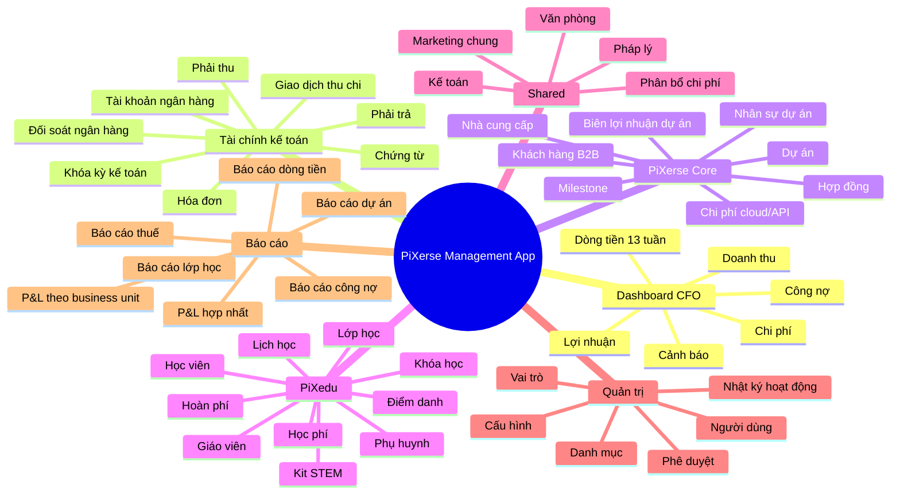
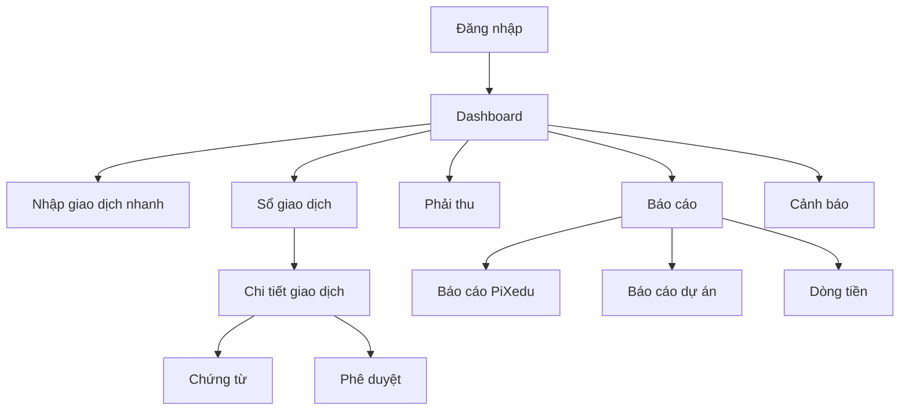

# Mind map ứng dụng quản lý PiXerse

## 1. Bản đồ tổng thể

## 2. Dây chuyền nghiệp vụ chính

```mermaid
flowchart LR
  A[Khách hàng / Phụ huynh] --> B[Hợp đồng / Đăng ký học]
  B --> C[Dự án / Lớp học]
  C --> D[Phát sinh doanh thu hoặc chi phí]
  D --> E[Gắn business unit]
  E --> F[Đính kèm hóa đơn, chứng từ]
  F --> G[Kiểm tra và phê duyệt]
  G --> H[Thu tiền / Thanh toán]
  H --> I[Đối soát ngân hàng]
  I --> J[Báo cáo CFO]
  J --> K[Quyết định và cảnh báo]
```

## 3. Cấu trúc menu đề xuất

### Tổng quan

- Dashboard CFO
- Việc cần xử lý
- Cảnh báo dòng tiền

### Tài chính

- Giao dịch
- Sổ cái
- Hóa đơn/chứng từ
- Phải thu
- Phải trả
- Ngân hàng
- Phân bổ chi phí

### PiXerse Core

- Khách hàng
- Nhà cung cấp
- Dự án
- Hợp đồng
- Milestone
- Chi phí dự án

### PiXedu

- Phụ huynh
- Học viên
- Khóa học
- Lớp học
- Giáo viên
- Học phí
- Điểm danh
- Kit STEM

### Báo cáo

- Báo cáo hợp nhất PiXerse
- Báo cáo PiXerse Core
- Báo cáo PiXedu
- Lãi/lỗ theo dự án
- Lãi/lỗ theo lớp học
- Dòng tiền
- Công nợ

### Quản trị

- Người dùng và phân quyền
- Danh mục
- Business unit
- Ngưỡng cảnh báo
- Nhật ký hoạt động
- Khóa kỳ kế toán

## 4. Luồng màn hình tối thiểu

## 5. Cách xây theo giai đoạn

### MVP 1: tài chính lõi

- Đăng nhập và phân quyền.
- Business unit.
- Nhập giao dịch.
- Chứng từ.
- Công nợ.
- Dashboard thu/chi/dòng tiền.

### MVP 2: quản lý PiXerse

- Khách hàng, nhà cung cấp.
- Dự án và hợp đồng.
- Milestone.
- Chi phí cloud/API.
- Báo cáo lãi/lỗ theo dự án.

### MVP 3: quản lý PiXedu

- Học viên và phụ huynh.
- Khóa/lớp học.
- Học phí.
- Điểm danh.
- Giáo viên và giáo cụ.
- Báo cáo hiệu quả từng lớp.

### MVP 4: kiểm soát CFO

- Phê duyệt nhiều cấp.
- Khóa kỳ kế toán.
- Đối soát ngân hàng.
- Phân bổ chi phí dùng chung.
- Dự báo dòng tiền.
- Báo cáo hợp nhất.

## 6. Nguyên tắc thiết kế

- Một pháp nhân: PiXerse.
- Nhiều business unit: `pixerse_core`, `pixedu`, `shared`.
- Mọi giao dịch phải truy ngược được tới người nhập, dự án/lớp và chứng từ.
- Không xóa dữ liệu tài chính; dùng soft delete và audit log.
- Báo cáo pháp nhân hợp nhất, báo cáo quản trị thì tách theo đơn vị.
- Chỉ xây màn hình khi xác định được quyết định quản trị mà màn hình đó hỗ trợ.
