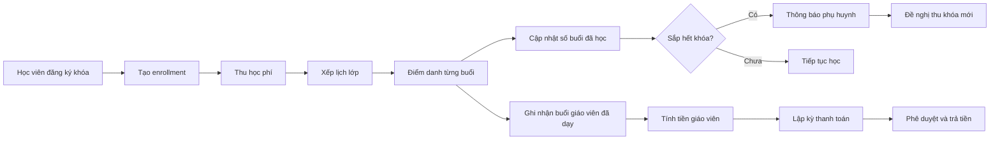

# Phân hệ PiXedu: học phí, buổi học và giáo viên

## 1. Mục tiêu

Phân hệ phải trả lời được:

- Học viên còn bao nhiêu buổi trong khóa?
- Khi nào cần thông báo đóng khóa mới?
- Học viên nào đã quá hạn học phí?
- Giáo viên đã dạy bao nhiêu buổi?
- PiXedu phải trả giáo viên bao nhiêu?
- Khoản nào đã trả, khoản nào sắp đến hạn?

## 2. Mô hình nghiệp vụ



## 3. Thông tin khóa học

Mỗi khóa học cần có:

- Tên khóa.
- Loại khóa: theo buổi, theo tháng hoặc theo học kỳ.
- Tổng số buổi.
- Thời lượng mỗi buổi.
- Học phí niêm yết.
- Số học viên tối thiểu/tối đa.
- Giáo viên phụ trách.
- Ngày bắt đầu/kết thúc dự kiến.
- Chính sách học bù và hoàn phí.
- Trạng thái: mở đăng ký, đang học, hoàn tất, tạm dừng.

Ví dụ:

```text
Khóa: Robotics cơ bản K10
Tổng số buổi: 12
Thời lượng: 90 phút/buổi
Học phí: 3.600.000 VND
Ngưỡng cảnh báo: còn 2 buổi
```

## 4. Thông tin đăng ký học

Mỗi học viên đăng ký một khóa cần có bản ghi `enrollment`:

- Học viên.
- Phụ huynh/người thanh toán.
- Khóa học/lớp học.
- Ngày đăng ký.
- Số buổi được mua.
- Số buổi đã học.
- Số buổi còn lại.
- Học phí phải thu.
- Đã thu bao nhiêu.
- Còn phải thu bao nhiêu.
- Ngày hết hạn gói học.
- Trạng thái: đang học, sắp hết buổi, chờ gia hạn, hoàn tất, bảo lưu.

Công thức:

```text
Số buổi còn lại = Số buổi đã mua - Số buổi đã học hợp lệ
```

## 5. Quy tắc thông báo học phí

Hệ thống cần chạy kiểm tra hàng ngày hoặc sau mỗi lần điểm danh.

### Cảnh báo sắp hết khóa

Tạo thông báo khi một trong các điều kiện đúng:

```text
Số buổi còn lại <= ngưỡng cảnh báo
```

hoặc:

```text
Ngày hết hạn gói học <= 14 ngày
```

Mức đề xuất:

- Còn 3 buổi: nhắc nội bộ.
- Còn 2 buổi: thông báo phụ huynh.
- Còn 1 buổi: tạo việc cần thu học phí.
- Còn 0 buổi: khóa đăng ký buổi mới nếu chưa gia hạn.

Không gửi lặp cùng một cảnh báo quá một lần mỗi chu kỳ khóa học.

### Nội dung thông báo mẫu

```text
Học viên Nguyễn Minh B còn 2/12 buổi trong khóa Robotics cơ bản K10.
Vui lòng đăng ký khóa tiếp theo trước ngày 25/10/2026.
Học phí dự kiến: 3.600.000 VND.
```

## 6. Quản lý buổi học và điểm danh

Mỗi buổi học cần lưu:

- Lớp/khóa.
- Ngày và giờ bắt đầu/kết thúc.
- Phòng hoặc hình thức học online.
- Giáo viên chính dạy buổi đó.
- Trợ giảng nếu có.
- Danh sách học viên đăng ký tại thời điểm buổi học.
- Điểm danh riêng cho từng học viên.
- Ghi chú chuyên môn.
- Trạng thái buổi: đã lên lịch, đã dạy, hủy, dạy bù.

### Bảng điểm danh từng buổi

Mỗi học sinh phải có một bản ghi điểm danh cho mỗi buổi:

```text
Buổi: Robotics K10 - buổi 5
Ngày: 20/10/2026
Giáo viên: Nguyễn Văn A
Học viên: Nguyễn Minh B
Trạng thái: Vắng có phép
Tính vào gói học: Có
Lý do: Nghỉ ốm
```

Các trạng thái điểm danh:

- `present`: Có mặt.
- `absent_excused`: Vắng có phép.
- `absent_unexcused`: Vắng không phép.
- `makeup`: Có mặt ở buổi học bù.
- `holiday`: Nghỉ lễ, không phải buổi học.
- `cancelled`: Buổi bị hủy bởi PiXedu, không tính vào gói học.

## 7. Quy tắc tính buổi học viên

### Học viên nghỉ vẫn tính buổi

Nếu buổi học đã diễn ra và không phải ngày lễ hoặc buổi bị PiXedu hủy, buổi đó được tính vào gói học dù học viên vắng:

```text
present           → trừ 1 buổi
absent_excused    → trừ 1 buổi
absent_unexcused  → trừ 1 buổi
makeup            → trừ 1 buổi bổ sung
holiday           → không trừ buổi
cancelled         → không trừ buổi
```

Công thức chính:

```text
Buổi đã sử dụng =
  số buổi có mặt
  + số buổi vắng có phép
  + số buổi vắng không phép
  + số buổi học bù
```

Không tính `holiday` và `cancelled` vào số buổi đã sử dụng.

### Học bù

Buổi học bù phải liên kết với buổi hoặc lý do phát sinh, ví dụ:

```text
makeup_for_session_id
makeup_reason
```

Học bù được tính là một buổi học bổ sung khi học viên tham dự. Nếu học viên đăng ký học bù nhưng tiếp tục vắng, không tự động trừ thêm một buổi cho tới khi buổi bù thực sự diễn ra theo quy định của PiXedu.

Để tránh tính trùng, hệ thống phải kiểm tra một buổi bù không được đồng thời ghi nhận là buổi chính của cùng học viên.

## 8. Ngày nghỉ lễ và lùi lịch

Ngày lễ cần được khai báo trước trong lịch PiXedu:

```text
holiday_date
holiday_name
applies_to
```

Khi một ngày học rơi vào ngày lễ:

1. Buổi học được chuyển sang trạng thái `holiday`.
2. Không trừ buổi của bất kỳ học viên nào.
3. Không tính tiền công giáo viên cho buổi đó.
4. Lịch các buổi còn lại được tự động lùi về ngày tiếp theo phù hợp.
5. Số buổi cam kết của khóa vẫn giữ nguyên.

Ví dụ:

```text
Khóa có 12 buổi.
Ngày 02/09 là ngày lễ và trùng buổi 4.
Buổi 4 không bị mất.
Các buổi sau được lùi lịch một tuần hoặc sang ngày học kế tiếp.
Tổng số buổi học viên vẫn nhận được: 12.
```

Nếu lớp có lịch học cố định theo tuần, hệ thống cần tạo lịch bù tự động vào tuần kế tiếp. Nếu có nhiều ngày lễ liên tiếp, lịch phải lùi tương ứng số ngày/buổi bị ảnh hưởng.

## 9. Cảnh báo thu học phí và học bù

Cảnh báo thu tiền dựa trên số buổi còn lại trong gói và thời điểm lớp sắp kết thúc, không dựa duy nhất vào ngày học cuối cùng trên lịch.

```text
Buổi còn lại = Buổi được mua - Buổi đã sử dụng
```

Trong đó:

- Buổi nghỉ của học viên vẫn làm giảm `Buổi còn lại`.
- Buổi lễ không làm giảm `Buổi còn lại`.
- Buổi học bù đã diễn ra làm giảm thêm `Buổi còn lại`.
- Lịch bị lùi do ngày lễ không làm mất quyền học.

Hệ thống vẫn phải thông báo thu học phí khóa mới khi:

- Còn 3 buổi: tạo nhắc nội bộ.
- Còn 2 buổi: thông báo phụ huynh.
- Còn 1 buổi: tạo việc cần thu tiền khóa mới.
- Còn 0 buổi: đánh dấu cần gia hạn trước buổi tiếp theo.

Thông báo phải hiển thị cả thông tin học bù nếu có:

```text
Nguyễn Minh B còn 2 buổi chính trong khóa Robotics K10.
Đã có 1 buổi học bù được ghi nhận.
Vui lòng đăng ký khóa mới trước ngày 25/10/2026 để đảm bảo lịch học liên tục.
```

Không được trì hoãn cảnh báo chỉ vì lịch cuối khóa bị lùi do ngày lễ. Lịch có thể lùi, nhưng trạng thái sử dụng gói học và thời điểm cần thu tiền vẫn phải được tính riêng.

## 10. Thống kê theo buổi và giáo viên

Mỗi buổi dạy cần có bảng tổng hợp:

```text
Ngày
Lớp
Giáo viên chính
Trợ giảng
Số học viên đăng ký
Số có mặt
Số vắng có phép
Số vắng không phép
Số học bù
Trạng thái buổi
```

Ví dụ:

```text
20/10/2026 | Robotics K10 | GV Nguyễn Văn A
Đăng ký: 10
Có mặt: 8
Vắng có phép: 1
Vắng không phép: 1
Học bù: 2
Buổi hợp lệ để tính công: 1
```

### Cách tính buổi cho giáo viên

Giáo viên được tính công theo buổi đã dạy thực tế, không theo số học viên có mặt:

```text
Buổi công giáo viên = số buổi có trạng thái `đã dạy`
```

Học viên nghỉ không làm giảm tiền công giáo viên nếu lớp vẫn diễn ra.

Ngày lễ, buổi bị PiXedu hủy hoặc buổi chưa được xác nhận thì không được tính công. Buổi học bù được tính thêm một buổi công nếu giáo viên thực sự dạy và buổi đã được xác nhận.

Nếu có mức trả khác nhau theo quy mô lớp, có thể dùng:

```text
Tiền công buổi = Đơn giá cơ bản + Phụ cấp theo số học viên
```

## 11. Bảng dữ liệu bổ sung

```text
holidays
class_sessions
session_teachers
attendance_records
makeup_sessions
enrollments
notifications
```

Các trường quan trọng:

```text
class_sessions
  id
  class_id
  scheduled_date
  actual_date
  status
  is_makeup
  makeup_for_session_id
  teacher_confirmed_at

attendance_records
  session_id
  student_id
  status
  counts_as_used_lesson
  note

session_teachers
  session_id
  teacher_id
  role
  counts_as_paid_session
  rate_snapshot
```

## 12. Quản lý giáo viên

Thông tin giáo viên:

- Họ tên và mã giáo viên.
- Loại hợp tác: nhân viên, cộng tác viên, freelancer.
- Môn/chuyên môn.
- Mức trả theo buổi hoặc theo giờ.
- Mức trả trợ giảng.
- Ngày chốt công.
- Ngày dự kiến thanh toán.
- Tài khoản nhận tiền.
- Hồ sơ hợp đồng/chứng từ.
- Trạng thái hoạt động.

## 13. Tính tiền giáo viên

### Theo buổi

```text
Tiền giáo viên = Số buổi đã dạy hợp lệ × Đơn giá/buổi
```

### Theo giờ

```text
Tiền giáo viên = Tổng số giờ đã dạy × Đơn giá/giờ
```

### Có trợ giảng

```text
Tổng chi phí buổi = Tiền giáo viên + Tiền trợ giảng + Phụ cấp khác
```

Chỉ tính tiền sau khi:

1. Buổi học đã kết thúc.
2. Điểm danh đã được xác nhận.
3. Giáo viên hoặc quản lý xác nhận buổi dạy.
4. Quản lý PiXedu duyệt.

## 14. Kỳ thanh toán giáo viên

Hệ thống cần hỗ trợ kỳ thanh toán:

- Theo tuần.
- Hai lần mỗi tháng.
- Theo tháng.
- Theo khóa học.

Một kỳ thanh toán gồm:

- Khoảng thời gian từ ngày nào đến ngày nào.
- Danh sách buổi đã dạy.
- Tổng giờ/buổi.
- Đơn giá áp dụng.
- Phụ cấp/khấu trừ.
- Tổng tiền phải trả.
- Người lập.
- Người duyệt.
- Ngày đến hạn.
- Ngày đã thanh toán.
- Trạng thái: nháp, chờ duyệt, đã duyệt, đã trả, quá hạn.

## 15. Cảnh báo thanh toán giáo viên

Tạo cảnh báo khi:

- Kỳ thanh toán sắp đến hạn trong 3 ngày.
- Đã quá ngày trả tiền.
- Có buổi dạy chưa được xác nhận.
- Có sai lệch giữa lịch dạy và bảng công.
- Có giáo viên chưa cung cấp thông tin thanh toán.

## 16. Các bảng dữ liệu đề xuất

```text
teachers
courses
classes
class_sessions
enrollments
attendance_records
tuition_invoices
tuition_payments
teacher_rates
teacher_payroll_periods
teacher_payroll_items
notifications
```

## 17. Màn hình cần có

### Quản lý PiXedu

- Tổng quan PiXedu.
- Học viên và phụ huynh.
- Khóa học/lớp học.
- Lịch học.
- Điểm danh.
- Học phí và gia hạn.
- Giáo viên.
- Bảng công giáo viên.
- Kỳ thanh toán giáo viên.

### Việc cần xử lý

- Học viên sắp hết buổi.
- Học phí quá hạn.
- Buổi học chưa điểm danh.
- Buổi dạy chưa xác nhận.
- Kỳ trả giáo viên sắp đến hạn.

## 18. Phân quyền

- Giáo viên: xem lịch và nhập điểm danh lớp được phân công.
- Giáo vụ/PiXedu Manager: quản lý lớp, học viên, học phí và xác nhận buổi học.
- Kế toán: ghi nhận thu học phí và thanh toán giáo viên.
- CFO/Admin: xem toàn bộ, duyệt bảng lương và cấu hình ngưỡng cảnh báo.
- Phụ huynh: chỉ xem lịch học, số buổi còn lại và công nợ của con mình nếu mở cổng phụ huynh.
